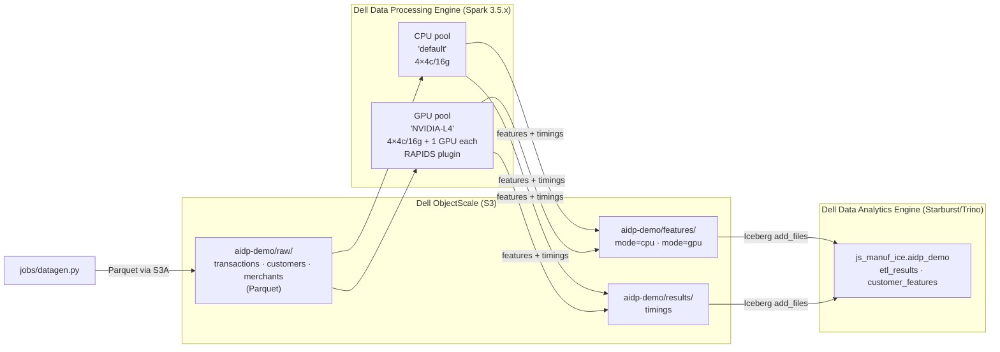

# AIDP Spark CPU vs GPU Demo

Run the **same PySpark job twice** on Dell Data Processing Engine (DPE,
Spark 3.5.x + NVIDIA Spark RAPIDS) — once on a CPU pool, once on a GPU pool —
with **zero code changes**. Only the Spark config differs between the two
runs. Results and output features are then queried in Dell Data Analytics
Engine (Starburst/Trino) to close the end-to-end AIDP story.

**Scenario — bank fraud feature pipeline:** a Southeast Asian bank prepares
AI-ready fraud features from card transactions every night. Scan/filter,
join+aggregate, window-based fraud signals, and a per-customer feature table.



The whole point: `diff conf/cpu.conf conf/gpu.conf` — no code change.

---

## Repo layout

| Path | Purpose |
|------|---------|
| `jobs/datagen.py` | Synthetic data → `s3a://$DEMO_BUCKET/aidp-demo/raw/` (Parquet) |
| `jobs/etl_benchmark.py` | The benchmark — identical file for both runs |
| `conf/common.conf` | Shared config: s3a settings, executor shape, AQE |
| `conf/cpu.conf` | common + nothing else (the "before") |
| `conf/gpu.conf` | common + RAPIDS keys (the "after") |
| `scripts/00_setup.sh` | CLI check, `config set`, login, bucket, code upload |
| `scripts/01_generate_data.sh` | Submit datagen (`ROWS=` controls scale) |
| `scripts/02_run_cpu.sh` / `03_run_gpu.sh` | Submit the benchmark to each pool |
| `scripts/04_collect.sh` | Status + log zips + extract `[bench]` summary tables |
| `scripts/register_tables.py` | Build Iceberg metadata over the Parquet + `register_table` in Starburst |
| `scripts/run_trino.py` | Execute `sql/starburst_compare.sql` via Trino Basic auth |
| `scripts/cleanup.sh` | Drop the schema + delete `aidp-demo/` from the bucket |
| `sql/starburst_compare.sql` | CPU-vs-GPU speedup + sample queries (tables built by register_tables.py) |

## One-time setup

```bash
cp .env.example .env       # fill in OBS_* / DPE_* / DDAE_* (or rely on
                           # ~/.cnc-demo-credentials — both name sets work)
./scripts/00_setup.sh
```

`00_setup.sh` verifies the DPE CLI (needs Java ≥ 22 — set `DPE_JAVA_HOME`),
runs `config set --api-endpoint` + `login-with-credentials --role $DPE_ROLE`,
checks the bucket, and copies `jobs/*.py` to `s3://$DEMO_BUCKET/aidp-demo/code/`
for reference. (DPE `submit` uploads the local main file automatically —
verified — so no `--py-files` plumbing is needed.)

Environment notes verified on this lab (see `.env.example`):

* Pools: `CPU_POOL=default`, `GPU_POOL=NVIDIA-L4`
* RAPIDS jar is pre-staged in the DPE GPU image
  (`/opt/spark/gpu/jars/rapids-4-spark.jar`, v25.12.0) — the pool does **not**
  inject it, so `gpu.conf` sets `spark.plugins=com.nvidia.spark.SQLPlugin`.
* Bucket creation is denied by the lab IAM keys → `DEMO_BUCKET=js-demo`.
* ObjectScale rejects the zero-byte `_SUCCESS` marker PUT (`BadDigest`), so
  `common.conf` sets `mapreduce.fileoutputcommitter.marksuccessfuljobs=false`.
* Finished batch instances are reaped quickly; the scripts pass
  `--ttl-seconds-after-finished=86400` so `instance status` keeps working.

---

## Presenter walkthrough (~15–20 min)

### 1. Set the scene (1 min)

"Same pipeline a bank would run nightly. We generate realistic card
transactions on ObjectScale, run the feature pipeline twice — CPU pool and
GPU pool — and serve the output through Starburst. Watch for one thing: the
code never changes."

### 2. Show the data (2 min)

```bash
ROWS=100000000 ./scripts/01_generate_data.sh
# → instanceId, UI URL. ~6-8 min for 100M rows.
```

Show the objects (any S3 browser or):

```bash
python3 - <<'EOF'
import boto3, os
s3 = boto3.client('s3', endpoint_url=os.environ['OBS_ENDPOINT'],
                  aws_access_key_id=os.environ['OBS_ACCESS_KEY'],
                  aws_secret_access_key=os.environ['OBS_SECRET_KEY'])
for p in ['raw/transactions/','raw/customers/','raw/merchants/']:
    r = s3.list_objects_v2(Bucket=os.environ['DEMO_BUCKET'], Prefix='aidp-demo/'+p)
    ks = r.get('Contents', [])
    print(p, len(ks), 'files', round(sum(o['Size'] for o in ks)/1e9,2), 'GB')
EOF
```

### 3. The only difference is config (1 min)

```bash
diff conf/cpu.conf conf/gpu.conf
```

Everything GPU-related lives in `gpu.conf`. `jobs/etl_benchmark.py` is
byte-identical for both runs — mode comes from `spark.demo.mode`.

### 4. Launch both runs side by side (kick off together)

Two terminals (they can also run back-to-back — same result):

```bash
./scripts/02_run_cpu.sh        # terminal 1 — prints instanceId + UI URL
./scripts/03_run_gpu.sh        # terminal 2
```

Each script prints its Spark UI URL
(`https://aidp-etl-{cpu,gpu}-ui.ddpe.lab9bgp.com` while RUNNING) and how to
tail logs. While they run, open the **GPU job's Spark UI → SQL tab** and point
out `GpuFileSourceScanExec`, `GpuHashAggregate`, `GpuShuffledHashJoin`,
`GpuShuffleExchangeExec`. The driver log also prints the Q2 physical plan and
any `NOT_ON_GPU` fallbacks live:

```bash
dell-data-processing-engine instance logs --insecure <gpu-instanceId> | grep -E 'bench|Gpu'
```

### 5. Results (2 min)

```bash
./scripts/04_collect.sh        # prints the [bench] summary table of each run
```

Driver log summary (real 100M GPU run):

```
[bench] query                          seconds          rows
[bench] scan-count                        4.61     100000000
[bench] q1_scan_filter_project            3.91             0
[bench] q2_join_aggregate                 5.55             0
[bench] q3_window_fraud_signals          12.45           349
[bench] q4_feature_table_write           11.42       9999554
[bench] TOTAL_WALL_CLOCK                 44.29
```

The same driver log prints the Q2 physical plan — every operator is `Gpu*`:

```
GpuColumnarToRow
+- GpuHashAggregate …
   +- GpuShuffleCoalesce
      +- GpuColumnarExchange gpuhashpartitioning(…, 200)
         +- GpuHashAggregate …
            +- GpuHashAggregate …
               +- GpuHashAggregate …
                  +- GpuProject …
                     +- GpuBroadcastHashJoin [merchant_id] … GpuBuildRight
                        :- GpuProject …
                        :  +- GpuShuffledSymmetricHashJoin [customer_id]
                        :     :- GpuColumnarExchange gpuhashpartitioning(customer_id, 200)
                        :     :  +- GpuCoalesceBatches
                        :     :     +- GpuFilter
                        :     :        +- GpuFileGpuScan parquet s3a://…/raw/transactions
                        :     +- GpuColumnarExchange … GpuFileGpuScan …/raw/customers
                        +- GpuBroadcastExchange … GpuFileGpuScan …/raw/merchants
```

### 6. Starburst: the speedup query (3 min)

```bash
./scripts/register_tables.py  # builds Iceberg metadata + registers tables
./scripts/run_trino.py        # runs sql/starburst_compare.sql
```

`register_tables.py` creates `js_manuf_ice.aidp_demo.etl_results` and
`customer_features` over the Parquet files Spark just wrote — metadata only,
no data rewrite — using pyiceberg + `CALL system.register_table` (this
cluster disables `add_files`; if yours has it enabled, the commented SQL in
`sql/starburst_compare.sql` shows the simpler path). Then the SELECTs print
the **per-query CPU vs GPU seconds and speedup** — the money shot. Follow
with the feature queries ("top risky provinces by fraud flags") to show
GPU-produced data is immediately queryable.

For the booth, the same SELECTs run read-only through the **DDAE MCP server**
(`queryReadOnly` tool) or the Starburst UI.

### 7. Close (1 min)

"One config file. Zero code changes. The features are already in Starburst
ready for the fraud model — that's the AIDP story: ingest on ObjectScale,
process on DPE, serve on DDAE."

---

## Measured results

> 100M transactions / 10M customers / 50K merchants. Two runs per mode —
> run 1 is the warm-up. Both modes produced **identical output**:
> 9,999,554 feature rows, 349 fraud flags.

| Query | CPU run 1 (s) | CPU run 2 (s) | GPU run 1 (s) | GPU run 2 (s) | Speedup (run 2) |
|-------|--------------:|--------------:|--------------:|--------------:|----------------:|
| scan-count | 2.24 | 2.22 | 4.79 | 4.61 | 0.48x |
| q1_scan_filter_project | 13.19 | 12.25 | 4.21 | 3.91 | **3.13x** |
| q2_join_aggregate | 66.02 | 66.39 | 5.29 | 5.55 | **11.97x** |
| q3_window_fraud_signals | 197.54 | 196.15 | 12.60 | 12.45 | **15.75x** |
| q4_feature_table_write | 95.19 | 94.97 | 10.74 | 11.42 | **8.32x** |
| **TOTAL_WALL_CLOCK** | **376.87** | **374.61** | **44.45** | **44.29** | **8.46x** |

Same numbers, as returned live by the Starburst speedup query:

```
query                        cpu_seconds  gpu_seconds  speedup_x
TOTAL_WALL_CLOCK                  374.61       44.29        8.46
q1_scan_filter_project             12.25        3.91        3.13
q2_join_aggregate                  66.39        5.55       11.97
q3_window_fraud_signals           196.15       12.45       15.75
q4_feature_table_write             94.97       11.42        8.32
scan-count                          2.22        4.61        0.48
```

10M-row dry run (same code): CPU 68.4s / GPU 40.3s wall clock — GPU pays a
fixed startup cost and wins even at small scale, but the gap widens with data.

Environment: DPE Spark 3.5.7, RAPIDS 25.12.0, pool `NVIDIA-L4` (NVIDIA L4),
4 executors × 4 cores × 16 GiB both modes, `spark.task.resource.gpu.amount=0.25`,
`concurrentGpuTasks=2`, AQE on, 100M transactions / 10M customers / 50K merchants.

## Why results vary (talk track)

* **Data size** — GPU pays a fixed plugin/JIT startup cost; it wins at scale.
  At 10M rows the wall-clock gap already shows; at 1M it may invert.
* **Shuffle & network** — joins still move data over the fabric. A run
  dominated by S3 reads + shuffle narrows the GPU advantage.
* **GPU model** — L4 vs A100/H100 changes absolute numbers, not the story.
* **CPU fallbacks** — anything `NOT_ON_GPU` in the log runs on CPU inside the
  GPU job. This demo's remaining fallbacks: the `noop` write sink (by design)
  and — see below — none others of consequence.
* **Known RAPIDS bug worked around** — mixed running + bounded window frames
  in one `WindowExec` crash with `Couldn't find _gpu_w*` on RAPIDS ≤ 26.02
  (fixed upstream #14533). Q3 materialises the running-window columns first
  so the bounded rolling-average runs in its own GPU pass — same fix needed
  on CPU too, so the code stays identical.

## Option B — "same hardware, one switch" baseline

For a cleaner causal claim, run the CPU job *on the GPU pool* with
`spark.rapids.sql.enabled=false` (submit `conf/cpu.conf` against
`--pool $GPU_POOL`). Same machines, one flag difference.

## Troubleshooting

| Symptom | Cause / fix |
|---|---|
| `BadDigest: Content-MD5 does not match` on `_SUCCESS` | ObjectScale quirk on zero-byte PUTs; `marksuccessfuljobs=false` is already in `common.conf` |
| `LinkageError … class file version 66.0` running the CLI | CLI needs Java ≥ 22 — set `DPE_JAVA_HOME` |
| `You are not authorized to perform this action` on submit | Logged in as `public`; re-login `--role jirawut_demo` |
| `Couldn't find _gpu_w*` in window stage | RAPIDS ≤26.02 mixed-frame bug — Q3 already splits the passes; don't merge them |
| GPU OOM / `RetryAndSplit` storms | Lower `concurrentGpuTasks`, raise `memoryOverhead`, shrink `shuffle.partitions` |
| Executors stuck pending on NVIDIA-L4 | Another job/notebook holds the GPUs; `instance list` to check |
| `add_files procedure is disabled` in Trino | Cluster config; use `register_tables.py` (pyiceberg metadata + `register_table`, needs `SET ROLE sysadmin`) |
| `Access Denied: Cannot execute procedure register_table` | Run `SET ROLE sysadmin` first — `register_tables.py` does it automatically |
| `Unexpected physical type INT96 for timestamp` | Older Spark builds write INT96 ts — `outputTimestampType=TIMESTAMP_MICROS` is in `common.conf`; already-written files can be rewritten locally with pyarrow |
| Iceberg writes on GPU | If you switch output to Iceberg ≥1.6 format, verify writer support in your RAPIDS version — Parquet is used here deliberately |

## Cleanup

```bash
./scripts/cleanup.sh    # drops js_manuf_ice.aidp_demo + s3://$DEMO_BUCKET/aidp-demo/
```

## Security

* All credentials come from env / `.env` (gitignored) — never committed.
* `conf/` files contain no secrets; s3a keys are injected at submit time.
* `--insecure` / `verify=False` TLS is used for this lab only (private TitanCA).
